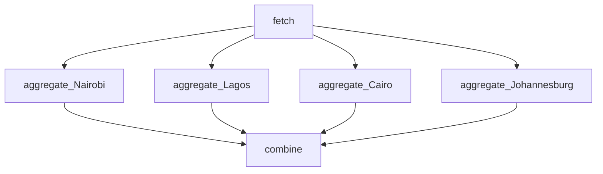

```text
____  _            ____
   / __ \(_)___  ___  / __ \________  ____ _____ ___
  / /_/ / / __ \/ _ \/ / / / ___/ _ \/ __ `/ __ `__ \
 / ____/ / /_/ /  __/ /_/ / /  /  __/ /_/ / / / / / /
/_/   /_/ .___/\___/_____/_/   \___/\__,_/_/ /_/ /_/
       /_/
```

<div align="center">

**The zero-dependency DAG orchestrator for data science pipelines.**

If Python can import it, PipeDream can run it — no scheduler to deploy,
no database to babysit, no Docker image to keep warm.

[](https://github.com/frenals/PipeDream/actions/workflows/ci.yml)
[](tests)
[](https://www.python.org)
[](https://github.com/frenals/PipeDream/blob/main/pyproject.toml)
[](LICENSE)
[](https://github.com/frenals/PipeDream)

</div>

---

## Why

Every data-science pipeline starts the same way: three notebook cells that
clearly belong together. Then the dependencies creep in, someone needs a
rerun, and suddenly you're deploying Airflow with a Postgres metastore just
to move a CSV from A to B.

PipeDream is the answer to a simple question: **what if the orchestrator
were just a library?**

- **Zero dependencies.** The entire engine is the Python standard library.
  Clone the repo and run — no virtualenv ceremony, no container image.
- **DAGs with real validation.** Cycles and missing dependencies are caught
  before a single step runs, with the offending path in the error message.
- **Parallel by default.** Independent steps run concurrently on a thread
  pool; a step becomes eligible the instant its dependencies finish.
- **Retries with exponential backoff**, per step.
- **Content-addressed caching.** Edit a step's code, change a parameter or
  change an upstream result — the cache invalidates itself.
- **Graphs for humans.** `graph` prints your DAG as a tree or as Mermaid
  syntax that renders natively on GitHub.

## The 60-second tour

```bash
git clone https://github.com/frenals/PipeDream.git
cd PipeDream
python -m pipedream run examples/01_sales_report.py
```

No `pip install`. No `requirements.txt`. Just Python 3.9+.

### Define steps, not boilerplate

```python
from pipedream import step, Pipeline

@step
def customers(ctx):
    """Extract: synthesize a customer base (seeded, reproducible)."""
    return generate_customers(400, seed=7)

@step(depends_on=["customers"])
def orders(ctx, customers):                 # upstream result injected by name
    return generate_sales(customers, seed=11)

@step(depends_on=["orders"])
def revenue_by_region(ctx, orders):
    ...                                     # aggregate order value by region

@step(depends_on=["customers", "orders"])   # runs in parallel with the above
def plan_mix(ctx, customers, orders):
    ...

@step(depends_on=["revenue_by_region", "plan_mix"])
def report(ctx, revenue_by_region, plan_mix):
    ...                                     # render the markdown report

pipeline = Pipeline("sales-report",
                    [customers, orders, revenue_by_region, plan_mix, report])
```

A step is a plain function plus metadata. Name a parameter after an
upstream step and PipeDream injects that step's result for you — or read
results from `ctx["step_name"]`, or from `ctx.params` for run
configuration.

### Watch it run

```text
$ python -m pipedream run examples/01_sales_report.py

◆ sales-report — 5 steps · parallel · 2 workers · cache on

  ✓ customers ..................... ok 0.00s
  ✓ orders ........................ ok 0.02s
  ✓ revenue_by_region ............. ok 0.00s
  ✓ plan_mix ...................... ok 0.00s
  ✓ report ........................ ok 0.00s

✓ sales-report completed in 0.03s — 5 ok
```

### Run it again

The cache hashes every step's code, the pipeline parameters and its inputs
— so the second run is instant *and* automatically correct when anything
changes:

```text
$ python -m pipedream run examples/01_sales_report.py

◆ sales-report — 5 steps · parallel · 2 workers · cache on

  ↻ customers ..................... cached cache hit
  ↻ orders ........................ cached cache hit
  ↻ revenue_by_region ............. cached cache hit
  ↻ plan_mix ...................... cached cache hit
  ↻ report ........................ cached cache hit

✓ sales-report completed in 0.01s — 5 cached
```

## Parallel by default

`examples/03_fan_out_fan_in.py` fans one fetch out to four regional
aggregations and merges the results:

```text
◆ fan-out-fan-in — 6 steps · parallel · 2 workers · cache off

  ✓ fetch ......................... ok 0.27s
  ✓ aggregate_Lagos ............... ok 0.30s
  ✓ aggregate_Nairobi ............. ok 0.30s
  ✓ aggregate_Cairo ............... ok 0.60s
  ✓ aggregate_Johannesburg ........ ok 0.60s
  ✓ combine ....................... ok 0.00s

✓ fan-out-fan-in completed in 0.87s — 6 ok
```

The same pipeline with `--serial` finishes in **1.47s** — the four
aggregations each sleep 0.3s to simulate an API call. The scheduler is a
ready-queue, not layer-by-layer batching: a step starts the moment its
dependencies are done, so short steps never wait for slow siblings.

## A data-science pipeline, end to end

`examples/02_churn_scoring.py` builds features, scores customers with a
hand-rolled logistic model and evaluates it — pure Python, no sklearn:

```text
◆ churn-scoring — 5 steps · parallel · 2 workers · cache on

  ✓ customers → features → score → evaluate → report

## Churn model — evaluation

| metric | value |
| --- | --- |
| customers | 800 |
| churn rate | 12.2% |
| accuracy | 89.0% |
| precision | 55.4% |
| recall | 52.0% |
| f1 | 53.7% |
| roc auc | 0.860 |

✓ churn-scoring completed in 0.02s — 5 ok
```

Synthetic data generators ship in `pipedream.data` — seeded, reproducible,
and just realistic enough to be interesting.

## The pipeline, in data-science terms

Strip away the naming and nearly every data-science workflow is the same
graph — pull data, build features, score, evaluate, report — with the odd
independent branch on the side:

```text
raw data ──► extract ──► features ──► score ──► evaluate ──► report
                            │
                            └──► data-quality checks    (independent branch)
```

PipeDream is that graph, made executable:

| You would say | PipeDream gives you |
| --- | --- |
| "A stage of my workflow" | `@step` — a plain Python function plus metadata |
| "Features need the extract first" | `depends_on=["extract"]`; the DAG is validated — cycles, missing deps — before anything runs |
| "Feed the feature table into scoring" | Name a function parameter after the upstream step; its result is injected |
| "Don't re-run what didn't change" | The content-addressed cache: SHA-256 over the step's source code, the run parameters and the pickled upstream values |
| "Score both model variants at once" | Independent branches run on a thread pool |
| "Try a different threshold" | `--param key=value` — parameters are part of the cache key, so each setting caches separately |

That fourth row is the one that changes your day-to-day. The cache is
persistent memoization — `functools.lru_cache`, but keyed on values and
surviving across runs. Here's the churn pipeline above after one edit: a
new feature added to `features()` that the model ignores:

```text
◆ churn-scoring — 5 steps · parallel · 2 workers · cache on

  ↻ customers ..................... cached cache hit
  ✓ features ...................... ok 0.00s      ← source changed: re-runs
  ✓ score ......................... ok 0.00s      ← its input changed: re-runs
  ↻ evaluate ...................... cached cache hit
  ↻ report ........................ cached cache hit

✓ churn-scoring completed in 0.01s — 2 ok · 3 cached
```

`customers` sits upstream of the edit, so it stays cached. `features`
re-runs because its code changed, and `score` re-runs because its *input
values* changed. But `score` produced byte-identical output — the new
feature isn't used — so `evaluate` and `report` hit the cache. Invalidation
is driven by the values flowing through the graph, not by "did an upstream
step execute". That is what makes iterating on early stages cheap: refactor
your extraction all you like; if the features it produces don't change, the
metrics step never fires.

## See your DAG

```text
$ python -m pipedream graph examples/01_sales_report.py

sales-report — synthetic sales data to a regional revenue + plan ARPU report
└── customers
    ├── orders
    │   ├── revenue_by_region
    │   │   └── report
    │   └── plan_mix
    │       └── report (repeated)
    └── plan_mix (repeated)
```

Diamond joins are marked `(repeated)`. And because GitHub renders Mermaid,
`graph --mermaid` output pastes straight into any markdown file:



## The CLI

```text
usage: pipedream [-h] [--version] {run,graph,list,clean} ...

run     execute a pipeline        --serial  run one step at a time
                                 -j N      cap parallel workers
                                 --no-cache
                                 --fail-fast
                                 --param KEY=VALUE
graph   print the DAG            --mermaid
list    list the pipeline steps
clean   delete cached results
```

Everything the CLI does is also plain Python: `pipeline.run()`,
`pipeline.graph()`, `Pipeline.from_module(module)`.

## Example gallery

| Example | What it shows |
| --- | --- |
| `examples/01_sales_report.py` | ETL shape: two extractions, parallel transforms, a report step |
| `examples/02_churn_scoring.py` | Feature engineering, scoring, pure-Python model metrics |
| `examples/03_fan_out_fan_in.py` | Parallel fan-out/fan-in with a visible speedup |
| `examples/04_earthquake_monitor.py` | **Real data, live schedule**: global quake activity from the USGS Feed API, refreshed every 12 h by GitHub Actions |

## Live from the real world

Everything above runs on synthetic data, which keeps the tour offline and
deterministic. But the whole point of an orchestrator is the real world, so
`examples/04_earthquake_monitor.py` runs on **live data with a real
schedule** — no API key, no extra packages, still pure standard library:

- **Extract** every earthquake on Earth of magnitude 2.5+ from the
  [USGS real-time Feed API](https://earthquake.usgs.gov/fdsnws/event/1/),
  with three retries and exponential backoff for the inevitable network
  hiccup.
- **Fan out** to four parallel aggregations: counts per magnitude band,
  a per-UTC-hour histogram, the strongest quake, and the quake most
  reported as felt by people nearby.
- **Report** to `reports/earthquakes.md` — a markdown dashboard of the
  last 24 hours, regenerated on every run.
- **Schedule**: the [Earthquake monitor
  workflow](.github/workflows/earthquakes.yml) runs the pipeline every
  12 hours on GitHub Actions and commits the refreshed report back to
  this repo — the repository is its own dashboard, and the commit history
  *is* the time series.

The example is also a lesson in cache discipline. `fetch` and `report`
declare `cache=False`: the world changes even when their code doesn't, so
those steps must run every time. The four aggregations stay cacheable —
they are pure functions of the fetched events — so an unchanged window
costs nothing. On a typical run:

```text
  ✓ fetch ......................... ok 1.08s     ← cache=off: hits the API
  ↻ by_band ....................... cached cache hit
  ↻ by_hour ....................... cached cache hit
  ↻ largest ....................... cached cache hit
  ↻ top_felt ...................... cached cache hit
  ✓ report ........................ ok 0.00s     ← cache=off: fresh timestamp
```

Parameters work here too: `--param hours=6` narrows the window, and because
parameters are part of the cache key, the 6-hour view caches separately
from the 24-hour one.

## Honest limitations

- **Threads, not processes.** Steps that wait on I/O (files, APIs,
  databases, subprocesses) parallelize beautifully; CPU-bound pure-Python
  steps share the GIL. For heavy compute, wrap it in a subprocess step.
- **One machine.** PipeDream is a library, not a distributed scheduler —
  that is the point. When you outgrow it, the DAGs port to Airflow or
  Prefect concept-for-concept.
- **Cache keys hash pickled inputs.** Multi-gigabyte intermediate values
  will make hashing measurable; set `cache=False` on those steps.

## Compared with the big kids

| | PipeDream | Airflow | Prefect | Dagster |
| --- | --- | --- | --- | --- |
| Dependencies | 0 | 100+ | dozens | dozens |
| Needs infrastructure | no | scheduler + DB + webserver | optional server | optional webserver |
| Time to first pipeline | 30 seconds | an afternoon | 10 minutes | 30 minutes |
| Runs on a Raspberry Pi | yes | please don't | probably | probably |
| Caching built in | yes | roll your own | roll your own | IO managers |

(Tongue-in-cheek, of course — every one of those tools is excellent once
your pipelines outgrow a single process. PipeDream optimizes for the years
before that.)

## Project layout

```text
pipedream/
├── steps.py       # Step + the @step decorator
├── dag.py         # dependency graph, cycle detection, topo sort
├── engine.py      # scheduler, retries, statuses, RunResult
├── cache.py       # content-addressed result cache
├── pipeline.py    # Pipeline container + module discovery
├── context.py     # RunContext passed to every step
├── render.py      # terminal output, trees, Mermaid, tables
├── cli.py         # run / graph / list / clean
└── data.py        # seeded synthetic data generators
```

## Development

```bash
pytest                              # 55 tests, no dependencies to install
python -S scripts/audit_stdlib.py   # prove only stdlib gets imported
```

### What CI runs

Every push to `main` and every pull request runs the workflow in
`.github/workflows/ci.yml` — the CI badge at the top of this page is its
live status. Four jobs:

| Job | What it proves |
| --- | --- |
| `pytest (3.9 … 3.13)` | The 55-test suite passes on every supported Python version. The 3.9 leg is pinned to `ubuntu-24.04` because the default runner image (Ubuntu 26.04) has no Python 3.9 build. |
| `example pipelines` | Every `examples/*.py` runs end to end with `--no-cache`, so the examples shown above can never silently rot. |
| `zero-dependency audit` | Imports the whole package with `site-packages` disabled (`python -S scripts/audit_stdlib.py`); a single third-party import fails the build, so the zero-dependency promise is enforced on every commit — not by vibes. |
| `workflow lint` | Runs `scripts/validate_workflows.py` over every workflow in `.github/workflows/`: cron expressions must be valid five-field syntax and the YAML structure must be sound. This job exists because a four-field cron string once shipped and silently killed a scheduled workflow at parse time — never again. |

## License

[MIT](LICENSE)
